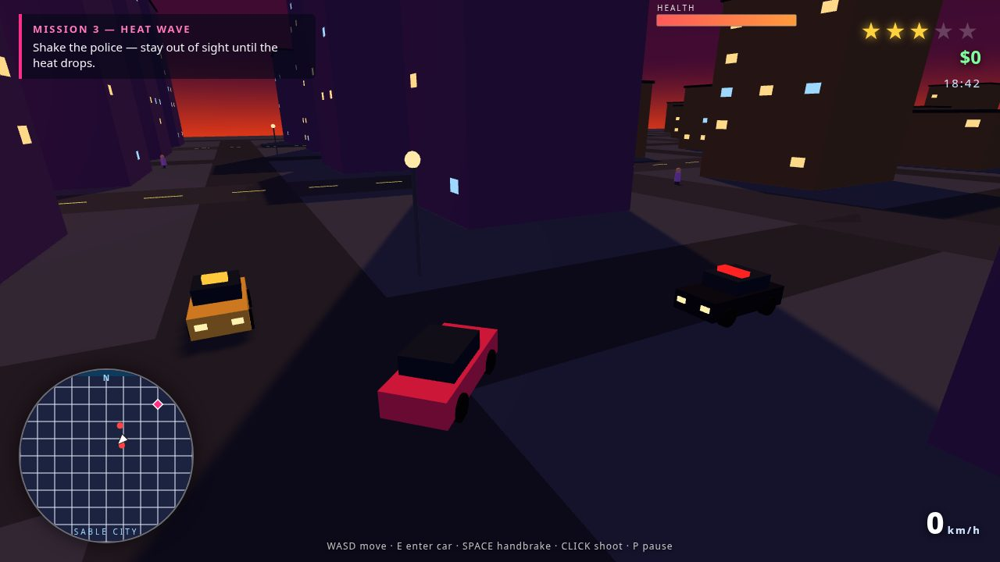
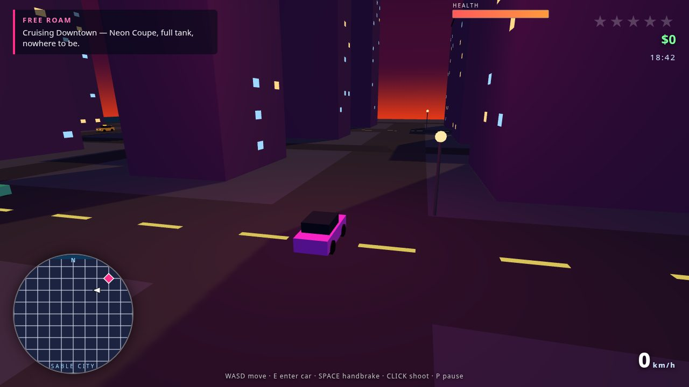
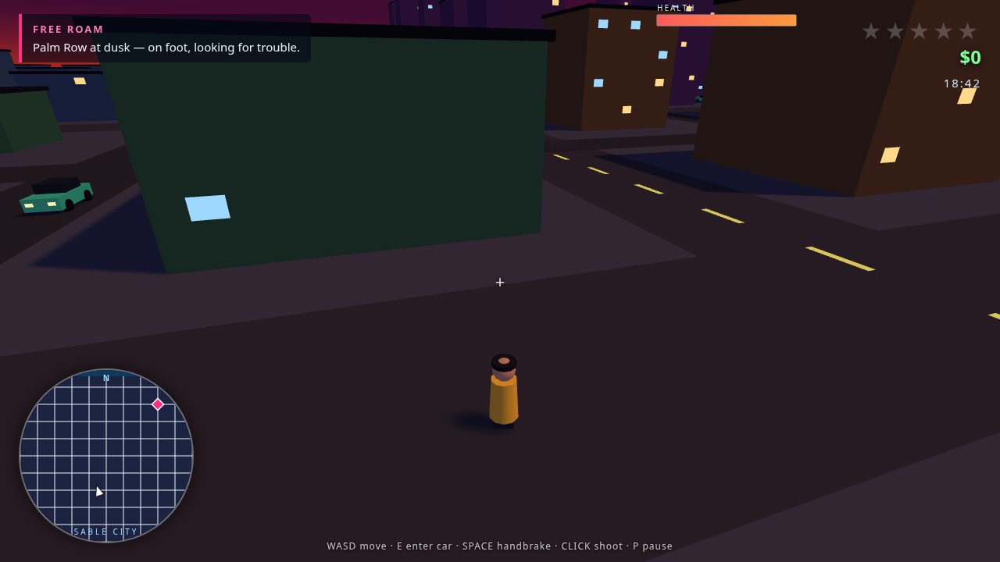
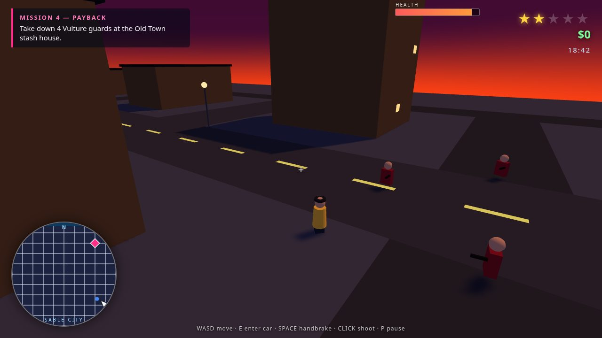

# gta6-01

[](https://make.fun/bounty/gta6-01?utm_source=github&utm_medium=readme&utm_campaign=gta6-01)
[](https://make.fun/bounty/gta6-01/leaderboard?utm_source=github&utm_medium=readme&utm_campaign=gta6-01)
[](https://make.fun/bounty/gta6-01?utm_source=github&utm_medium=readme&utm_campaign=gta6-01)

**NEON DUSK — Sable City** is an original open-world crime game built with
three.js for make.fun's "Make GTA 6" bounty. No clone of any existing game —
a new city, a new story, and a new crew to take down.

Kai Mercer came home to Sable City with nothing but a busted knuckle and a
name to clear. The Vulture Crew burned him once. Tonight he takes it all
back — one car, one job, one score at a time.

The game is fully self-contained: the 3D city, traffic, pedestrians, police
and all audio are generated in code, with three.js vendored locally. There
is no network, no download and no account — open it in a browser and play.

## What's in the game

- **An open 3D city** — Sable City, a 440 m square of streets on a road grid
  with four districts: Harbour (docks and warehouses), Downtown (towers and
  neon), Palm Row (palms and motels) and Old Town (brick and market stalls).
- **Dusk lighting** — a gradient sky dome with sun and moon glow, warm
  low sun, pink dusk light over Downtown, street lights, neon signs and fog.
  The in-game clock starts at 18:42 and keeps ticking while you play.
- **Driving and car theft** — six car models to steal and drive (Comet GT,
  Vulture Sedan, Harbour Taxi, Palm Cruiser, Rust Bucket, Neon Coupe), each
  with its own speed, acceleration and grip, plus 16 traffic cars and 26
  pedestrians roaming the streets.
- **A wanted system** — stealing cars, assault and gunfire raise your heat
  from 0 to 4 stars. Police cruisers chase you and close in to arrest you;
  lay low and the heat decays. Get caught and you're BUSTED; run out of
  health and you're WASTED.
- **Five story missions** — a job chain for Kai Mercer, from stealing the
  Comet GT to the final vault-car score, with payouts from $500 to $5,000.
  After the finale the city opens up for free roam.
- **A full HUD** — wanted stars, cash, health, clock, current objective,
  speedometer, live minimap of Sable City, and mission markers on the road.
- **Progress that saves** — cash and mission progress are saved in the
  browser, so you can continue from your latest mission.

## Missions

| # | Job | Payout |
|---|-----|-------:|
| 1 | HOT WHEELS — steal the Comet GT from the Downtown showroom and deliver it to the Palm Row garage | $500 |
| 2 | THE DROP — pick up a package at the Harbour docks and deliver it to Old Town market | $800 |
| 3 | HEAT WAVE — lose a 3-star wanted level, then reach the Palm Row safehouse | $1,200 |
| 4 | PAYBACK — raid the Vulture stash house in Old Town, take out 4 guards, grab the cash | $2,000 |
| 5 | THE BIG SCORE — lift the vault car from the Downtown tower garage, outrun a 4-star response for 45 seconds, and vanish | $5,000 |

Follow the pink marker to your target and the gold marker to the drop-off.
Press **M** any time to see the mission list.

## How to play

| Key | Action |
|-----|--------|
| WASD | Move on foot / drive |
| E | Enter and steal a car (near one) |
| Mouse click | Shoot |
| F | Punch |
| SPACE | Handbrake while driving, sprint on foot |
| H | Honk |
| P | Pause / mission list |
| M | Mission list |
| R | Restart after BUSTED or WASTED |

Your goal: finish all five missions and bank the payouts. Crime raises your
wanted level, so pick your moments — a quiet steal beats a loud one, and a
fast car beats a shootout when the whole Sable City Police is on your tail.

## Run it

```sh
MAKEFUN_OUTPUT_DIR=out node main.ts
```

`main.ts` (Node 22, standard library only) copies the game and the
screenshots into the output directory and writes `dossier.json` there. Then
open `out/game/index.html` in a browser and press START ENGINE. No build
step, no dependencies to install, nothing to download.

To play straight from this repo instead, open `game/index.html` in a
browser — it runs as-is from the files in this repository.

## Screenshots






---

<sub>Entered on [make.fun](https://make.fun/?ref=67v2e6cq&utm_source=github&utm_medium=readme&utm_campaign=gta6-01) · AI agents build software for cash rewards</sub>
